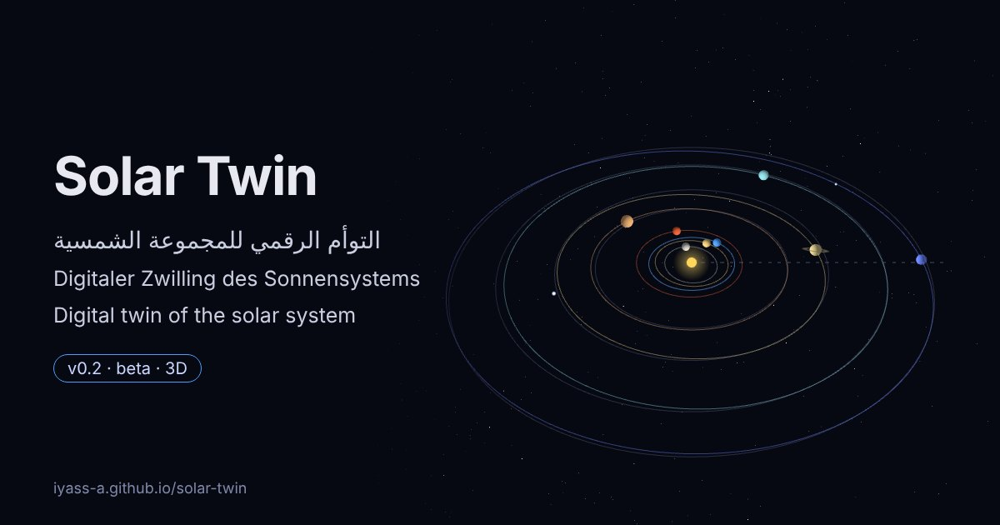

# Solar Twin

**A live digital twin of the solar system, in your browser.**
التوأم الرقمي للمجموعة الشمسية · Digitaler Zwilling des Sonnensystems

**Open it:** https://iyass-a.github.io/solar-twin/ (Arabic, German, English)



Version 0.2, public beta.

## What you can do

- **See where the planets are right now**, or on any date from 1800 to 2050. Drag the time bar, play time at a day up to a year per second, or jump to a date.
- **3D view.** Turn and zoom the scene, and follow a planet with the camera while time runs. Saturn's rings sit at their real tilt, and the 5,080 stars visible to the naked eye are in their true places behind.
- **Map from above (2D)**, with all planets at compressed distances, all at true distances, or just the inner planets.
- **Pick a planet** to see its distance from the Sun and from Earth, and how long its light takes to reach us.
- **Three languages.** Arabic (right to left), German and English. Add `?lang=ar`, `?lang=de` or `?lang=en` to the address to share a link in one language.

## How accurate is it?

Planet positions are computed from JPL's Keplerian elements (Table 1, valid 1800 to 2050).
Every build compares them with [Astronomy Engine](https://github.com/cosinekitty/astronomy) on every 10th day of that range, 9,168 dates in all.
The largest difference is **0.20°** (Saturn, 1911); the build fails above 1°.
The page also runs this check for the date on screen.

That is plenty for seeing where the planets are, but it is not meant for pointing a telescope or planning a spacecraft.

## How it works

| Part | File |
| --- | --- |
| Julian Date and time since J2000 | `src/astro/julian.ts` |
| Keplerian elements from JPL | `src/astro/elements.ts` |
| Kepler's equation, positions and orbits | `src/astro/kepler.ts` |
| Equatorial to ecliptic coordinates | `src/astro/frames.ts` |
| Saturn's pole (IAU) | `src/astro/poles.ts` |
| 2D map (canvas) | `src/view/orrery.ts` |
| 3D scene (Three.js) and the stars | `src/view/scene3d.ts`, `src/view/stars.ts` |
| Texts in three languages | `src/i18n.ts` |
| All self-checks | `scripts/check.ts` |

Everything runs in the browser. There is no server, no cookies, and nothing is loaded from other sites; only the chosen language is saved in your browser.

## Run it locally

You need [Node.js](https://nodejs.org/) 22 or newer.

```
npm install
npm run dev
```

Then open the address it prints (usually http://localhost:5173).

Run all checks (accuracy, 3D mapping, Saturn's tilt, star data, texts in three languages). The last line must say `RESULT: OK`:

```
npm run check
```

Every push to `main` runs the checks, builds the site and publishes it to GitHub Pages.

## Data and libraries

- Planet elements: E. M. Standish, JPL, [Approximate Positions of the Planets](https://ssd.jpl.nasa.gov/planets/approx_pos.html)
- Accuracy check: [Astronomy Engine](https://github.com/cosinekitty/astronomy) by Don Cross (MIT)
- Saturn's pole: Archinal et al. 2018, [Report of the IAU Working Group on Cartographic Coordinates and Rotational Elements: 2015](https://doi.org/10.1007/s10569-017-9805-5)
- Stars: Yale Bright Star Catalogue, 5th revised edition (Hoffleit & Warren 1991), in the [JSON conversion by Bretton Wade](https://github.com/brettonw/YaleBrightStarCatalog) (MIT, see `public/LICENSE-bsc5.txt`). `scripts/make-stars.ts` turns it into `src/data/stars.json`.
- 3D: [Three.js](https://threejs.org/) (MIT)

## What's next

Asteroids and comets with their uncertainty clouds, live data (Deep Space Network, space weather), a physics sandbox to "branch reality", a trip planner, and a guide you can ask questions in three languages.

Found something wrong, or have an idea? [Open an issue](https://github.com/Iyass-A/solar-twin/issues/new).

See [CHANGELOG.md](CHANGELOG.md) for what changed in each version.
